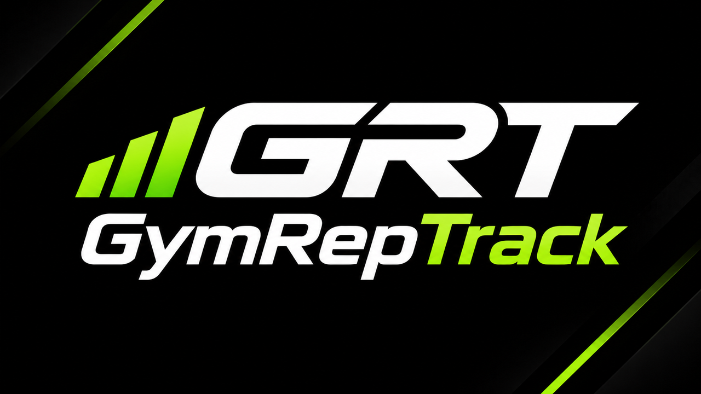

# GRT · GymRepTrack

<a href="#english">🇬🇧 English</a> · <a href="#lietuviškai">🇱🇹 Lietuviškai</a>

## English

A workout log right inside Telegram – nothing to install, works on Android, iPhone and desktop.

👉 **Open:** [@GymRepTrack_bot](https://t.me/GymRepTrack_bot)  
📢 **News:** [t.me/gymreptrack](https://t.me/gymreptrack)

### Features
- **Your program** – days, exercises, sets, rest time; weights (kg / lb, drop sets), **bodyweight** exercises (reps, optional added weight) and cardio
- **Fast logging** – last time's numbers are already in the fields, a set is ticked off with one ✓, finished exercises collapse
- **Rest timer** – when rest ends the bot sends a message, so your smartwatch or fitness band vibrates; the message deletes itself
- **Notes** – 📌 machine settings and technique shown every time, 💬 how today went, visible next time under “Last time”
- **Weight increase tips** – when you hit the same weight 2 or more times in a row (can be turned off)
- **Records and progress** – personal records, 1RM, charts, calendar history with filters
- **Weekly and monthly summaries** – the bot sends them every Sunday at 20:00 and on the last day of the month
- **Workout card** – a PNG arrives in your bot chat, share it anywhere from there
- **Move from Hevy / Strong** – import your workout history from their CSV export (beta)
- **Your data is safe** – stored in your Telegram cloud and synced between devices; the bot sends a backup once a week
- **Lithuanian and English** – picked automatically, can be changed in Settings

### Why it's different
Not another app on your phone: GRT lives in Telegram, which you already have. No sign-up, passwords or subscription – and the end of your rest arrives as a normal Telegram message, so your watch vibrates without any extra apps.

### Changelog
All versions: [CHANGELOG.md](CHANGELOG.md) and [Releases](../../releases). This page updates automatically.

### Privacy
The server only keeps the minimal technical data needed to run. Your workout data stays on your device and in your Telegram cloud; weekly and monthly summaries are kept on the server only until they are sent.

---

## Lietuviškai

Treniruočių dienoraštis tiesiai Telegram'e – nieko diegti nereikia, veikia Android, iPhone ir kompiuteryje.

👉 **Atidaryti:** [@GymRepTrack_bot](https://t.me/GymRepTrack_bot)  
📢 **Naujienos:** [t.me/gymreptrack](https://t.me/gymreptrack)

### Ką moka
- **Tavo programa** – dienos, pratimai, serijos, poilsio laikas; svoriai (kg / lb, drop-set), **savo svorio** pratimai (pakartojimai, papildomas svoris neprivalomas) ir kardio
- **Greita treniruotė** – praeito karto rezultatai jau laukeliuose, serija pažymima vienu ✓, atlikti pratimai susiskleidžia
- **Poilsio laikmatis** – pabaigoje botas atsiunčia žinutę: suvibruoja ir išmanusis laikrodis ar apyrankė; žinutė pati išsitrina
- **Pastabos** – 📌 treniruoklio nustatymai ir technika rodomi kiekvieną kartą, 💬 kaip sekėsi šiandien – matysi kitą kartą prie „Praeitą kartą“
- **Patarimai kelti svorį** – kai tą patį svorį padarai 2 ar daugiau kartų iš eilės (galima išjungti)
- **Rekordai ir progresas** – asmeniniai rekordai, 1RM, grafikai, istorija kalendoriuje su filtrais
- **Savaitės ir mėnesio suvestinės** – botas atsiunčia kiekvieną sekmadienį 20:00 ir paskutinę mėnesio dieną
- **Treniruotės kortelė** – PNG atkeliauja į pokalbį su botu, iš ten pasidalinama bet kur
- **Perkėlimas iš Hevy / Strong** – treniruočių istorijos importas iš jų CSV eksporto (bandomoji funkcija)
- **Duomenys saugūs** – tavo Telegram debesyje, sinchronizuojami tarp įrenginių; kartą per savaitę botas atsiunčia atsarginę kopiją
- **Lietuvių ir anglų kalba** – parenkama automatiškai, galima pakeisti Nustatymuose

### Kuo kitoks
Ne dar viena programėlė telefone: GRT gyvena Telegram'e, kurį jau turi. Nereikia registracijos, slaptažodžių ar prenumeratos, o poilsio pabaiga ateina kaip įprasta Telegram žinutė – todėl laikrodis suvibruoja be jokių papildomų programų.

### Pakeitimai
Visos versijos: [CHANGELOG.md](CHANGELOG.md) ir [Releases](../../releases). Puslapis atnaujinamas automatiškai.

### Privatumas
Veikimui serveris saugo tik minimalius techninius duomenis. Treniruočių duomenys lieka tavo įrenginyje ir tavo Telegram debesyje; savaitės ir mėnesio suvestinės serveryje laikomos tik iki jų išsiuntimo.
